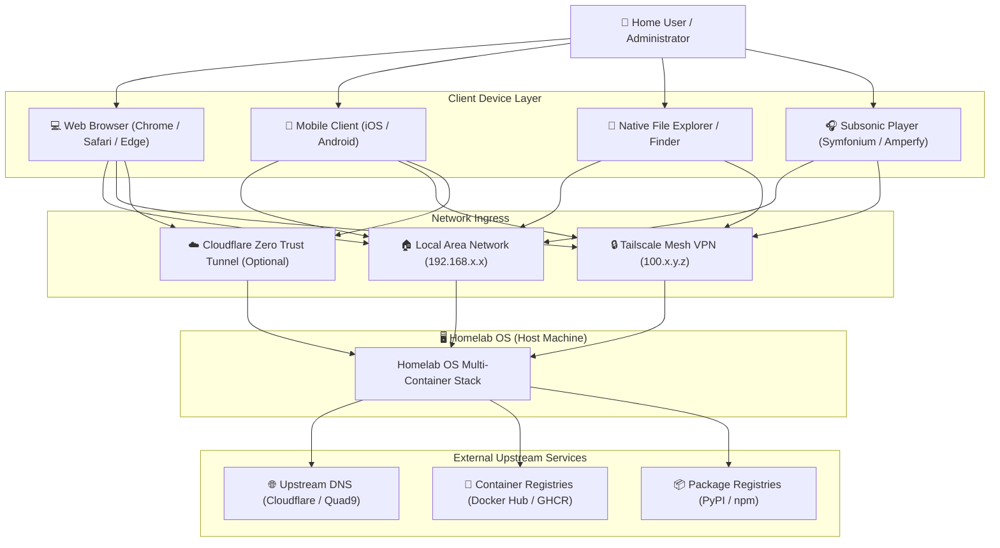
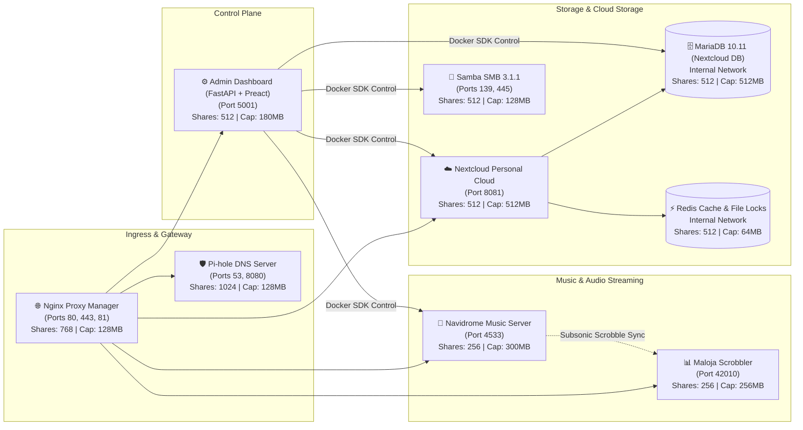
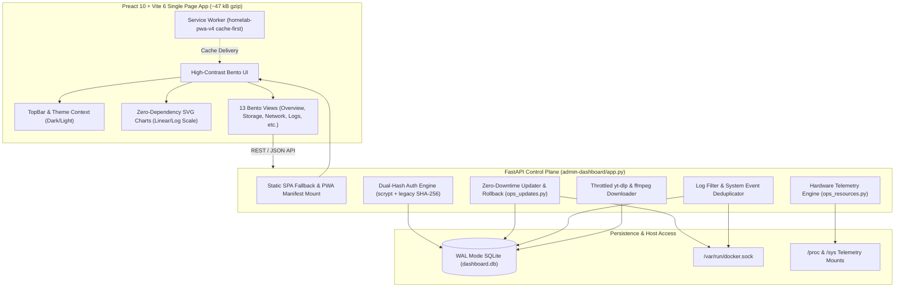

# Homelab OS: Architecture & Engineering Specification

This document details the architectural design, resource scheduling, network security perimeter, and concurrency models underlying **Homelab OS (HL-OS)**.

---

## 🏗️ 1. C4 Architecture Specification

### 1.1 Level 1: System Context Diagram

The following diagram illustrates how clients and external services interface with Homelab OS:



---

### 1.2 Level 2: Container Diagram (Services Layer)

Homelab OS isolates functionality into 9 coordinated containers with explicit network and storage boundaries:



---

### 1.3 Level 3: Admin Dashboard Component Diagram

The internal architecture of the modernized FastAPI + Preact Control Plane:



---

## 2. Low-Spec Optimization Rationale

### 2.1 Memory Envelope (2-Core Celeron & 8GB RAM Baseline)

On a typical 8 GB memory host, allocating too much RAM to container heaps triggers Linux kernel out-of-memory (OOM) killer events and starves the page cache, severely degrading mechanical drive or cheap SSD read/write speeds. 

Homelab OS enforces strict **hard memory caps** and balanced **soft reservation limits**:

| Container | Hard Cap | Soft Reservation | Tuning Technique |
| :--- | :---: | :---: | :--- |
| **Pi-hole** | 128 MB | 64 MB | FTL memory-mapped database cache tuning. |
| **Nginx Proxy Manager** | 128 MB | 64 MB | Minimal worker processes (`auto`), gzip buffer limits. |
| **MariaDB 10.11** | 512 MB | 256 MB | `innodb_buffer_pool_size=256M`, max connections capped at 64. |
| **Nextcloud** | 512 MB | 256 MB | `pm.max_children=12`, low-spec PHP OPcache buffer caps. |
| **Redis** | 64 MB | 32 MB | `maxmemory 48mb` with `allkeys-lru` eviction policy. |
| **Samba (SMB3)** | 128 MB | 64 MB | Socket options tuned for throughput over raw buffers. |
| **Admin Dashboard** | 180 MB | 64 MB | Multi-stage Alpine Python runtime, stripped virtualenv. |
| **Navidrome** | 300 MB | 128 MB | In-memory cache limits, single-threaded transcode pipe. |
| **Maloja** | 256 MB | 96 MB | SQLite backing store with optimized vacuum index. |
| **TOTALS** | **~2,240 MB (~2.2 GB)** | **~968 MB (~1.0 GB)** | **Leaves ~5,952 MB (~5.8 GB) free for Host Page Cache** |

---

### 2.2 CPU Share Scheduling

Docker default settings assign equal priority (1024 shares) to all containers. In Homelab OS, CPU shares are statically tiered to guarantee latency-sensitive services remain completely unaffected by heavy background jobs:

```
[1024 Shares]  Pi-hole DNS                (Real-time network DNS resolution: 0 packet drops)
     │
[768 Shares]   Nginx Proxy Manager        (HTTP/TLS request routing and SSL termination)
     │
[512 Shares]   Nextcloud / MariaDB / SMB  (Interactive file transfer & database queries)
     │
[512 Shares]   Admin Dashboard            (Management UI & live hardware polling)
     │
[256 Shares]   Navidrome / Maloja         (Audio streaming & scrobble processing)
     │
[nice -n 19]   Background Workers         (Audio conversions, yt-dlp, and backup dumps)
```

---

## 3. Storage Topology & Concurrency Model

### 3.1 Dual-Layer Resilient Samba Architecture
Network shares suffer from disconnections on sleeping laptop clients. Homelab OS addresses this on two levels:
1. **Server-Side (`config/samba/smb.conf`):**
   - **SMB 3.1.1 Protocol Negotiation:** Enforces modern encryption and durable handles (`smb2 leases = yes`).
   - **Apple VFS Extensions:** Configured with `vfs objects = catia fruit streams_xattr` to prevent file lock corruption during macOS Finder metadata operations (`.DS_Store`).
2. **Client-Side ([`scripts/client_smb_watchdog.sh`](file:///Users/beingbrijesh/homelab-framework/scripts/client_smb_watchdog.sh)):**
   - Background daemon on client machines monitors mount points every 15 seconds. If a connection drops during laptop sleep, it re-mounts the volume transparently without freezing user applications.

### 3.2 SQLite Write-Ahead Logging (WAL)
Both the Admin Dashboard database (`dashboard.db`) and Maloja use SQLite configured with:
* `PRAGMA journal_mode=WAL;`
* `PRAGMA synchronous=NORMAL;`
* `PRAGMA busy_timeout=30000;`

This enables concurrent read operations from the UI while background threads append telemetry and audit logs without deadlocks or `database is locked` errors.

---

## 4. Zero-Trust Network Perimeter

```
                         Cloudflare Edge
                                │
                  [Cf-Access-Authenticated-User-Email]
                                │
                                ▼
                       Nginx Reverse Proxy
                                │
                  ┌─────────────┴─────────────┐
                  ▼                           ▼
          LAN / Tailscale IP             Public Host
                  │                           │
          [Direct Access]             [Enforce Email Match]
                  │                           │
                  └─────────────┬─────────────┘
                                ▼
                       Admin Dashboard & Apps
```

1. **Private Subnets & Tailscale:** All private traffic (LAN `192.168.0.0/16`, `10.0.0.0/8` and Tailscale `100.64.0.0/10`) bypasses Cloudflare Access rules.
2. **Public Proxies:** When accessed through Cloudflare tunnels, the Admin Dashboard verifies the cryptographic `Cf-Access-Authenticated-User-Email` header against `ALLOWED_ZERO_TRUST_EMAILS`. Requests without a matching identity header are rejected immediately.
